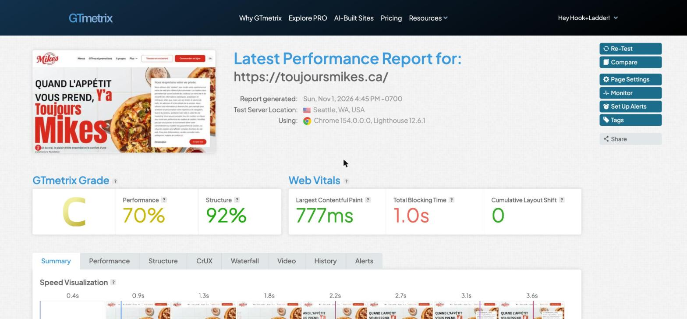
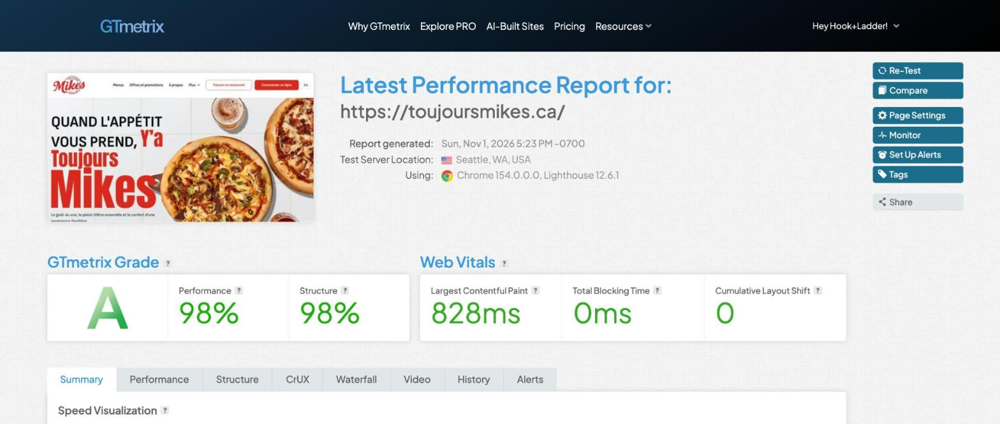
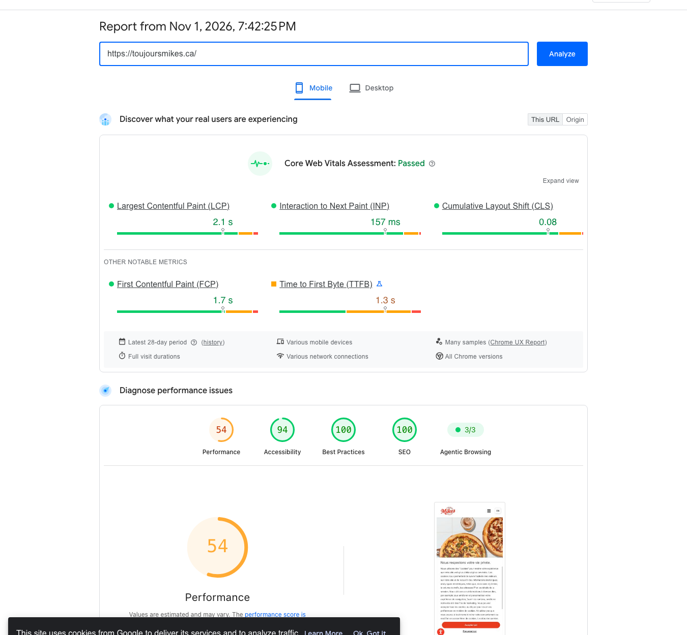
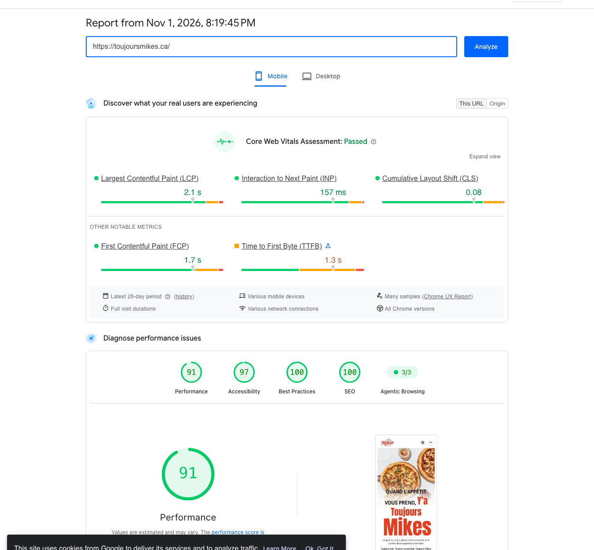
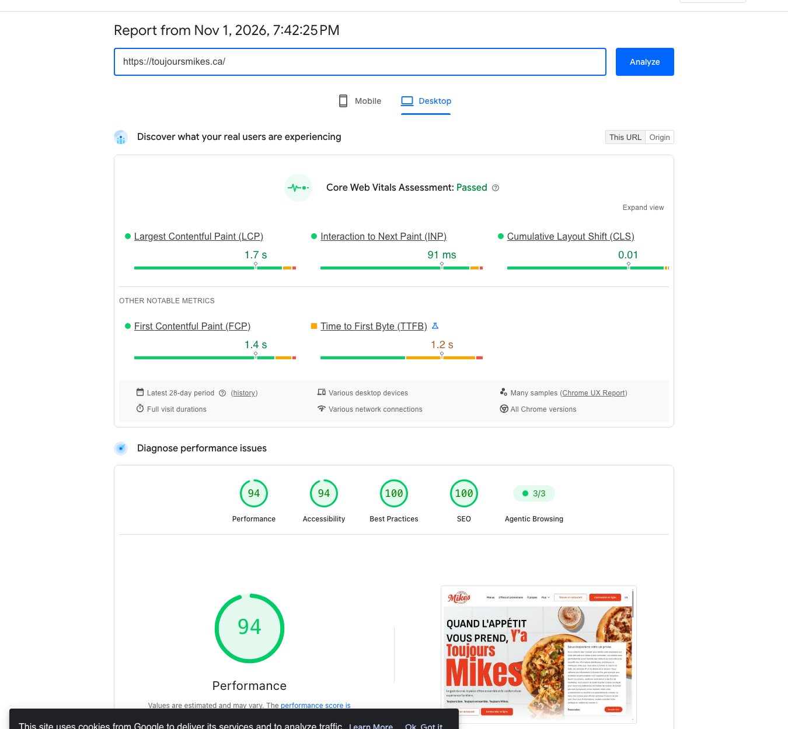
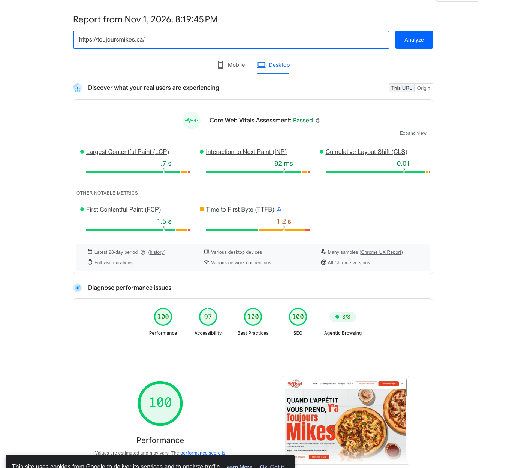

Report

# Performance scores

I tested three representative templates: the **home page**, the **blog archive** (`/blogue/`) and a **menu category** (`/menus/livraison-a-emporter/pizzas/`). After-tests ran on a warm cache.

## GTmetrix — home page

  <figure class="shot">
    
    <figcaption><b>Before</b> Nov 1 · Grade C · 70% · TBT 1.0 s</figcaption>
  </figure>
  <figure class="shot">
    
    <figcaption><b>After</b> Nov 1 · Grade A · 98% · TBT 0 ms</figcaption>
  </figure>

| Metric | Before | After |
|---|---|---|
| Grade | C | **A** |
| Performance / Structure | 70% / 92% | **98% / 98%** |
| Largest Contentful Paint | 777 ms | 828 ms |
| Total Blocking Time | 1.0 s | **0 ms** |
| Time to Interactive | 3.2 s | **1.0 s** |
| Fully Loaded | 3.6 s | **2.3 s** |
| Page size / requests | 2.63 MB / 137 | **1.06 MB / 53** |

## PageSpeed Insights

Scores are **Performance / Accessibility / Best Practices / SEO**.

| Page | Device | Before | After | TBT |
|---|---|---|---|---|
| Home | Mobile | 54 / 94 / 100 / 100 | **91** / 97 / 100 / 100 | 590 → **0 ms** |
| Home | Desktop | 94 / 94 / 100 / 100 | **100** / 97 / 100 / 100 | 190 → **0 ms** |
| Blog | Mobile | 64 / 88 / 100 / 100 | **82** / 94 / 100 / 100 | 420 → **0 ms** |
| Blog | Desktop | 99 / 94 / 100 / 100 | **100** / 93 / 100 / 100 | 100 → **0 ms** |
| Menu — Pizzas | Mobile | 62 / 91 / 100 / 92 | **72** / 94 / 100 / 92 | 380 → **0 ms** |
| Menu — Pizzas | Desktop | 76 / 94 / 100 / 92 | **95** / 93 / 100 / 92 | 190 → **0 ms** |

CLS stays between **0 and 0.017** on every page and device.

  <figure class="shot">
    
    <figcaption><b>Home · mobile, before</b> 54 · LCP 10.4 s · TBT 590 ms</figcaption>
  </figure>
  <figure class="shot">
    
    <figcaption><b>Home · mobile, after</b> 91 · LCP 3.3 s · TBT 0 ms · hero fully rendered</figcaption>
  </figure>

  <figure class="shot">
    
    <figcaption><b>Home · desktop, before</b> 94 · TBT 190 ms</figcaption>
  </figure>
  <figure class="shot">
    
    <figcaption><b>Home · desktop, after</b> 100 · LCP 0.5 s · TBT 0 ms</figcaption>
  </figure>

The menu category page lists every item with its photo, so its mobile score reflects that image payload under simulated slow 4G. Blocking time is zero and the layout is stable (CLS 0); on desktop the same page scores 95.

## Real-user data (CrUX)

The home page already **passes Core Web Vitals on mobile** for real visitors (LCP 2.1 s · INP 157 ms · CLS 0.08, 28-day window, visible at the top of both mobile captures). That window predates this cycle, so it is the baseline the new numbers will be measured against.
